<p align="center">
  
</p>

<h1 align="center">Ectolens</h1>

<p align="center">
  <strong>Spectacle, evolved.</strong><br>
  Screenshots and screen recordings for KDE Plasma, from one key.<br>
  Frame anything, then capture it or record it from the same toolbar.<br>
  Plus many more <a href="#what-ectolens-adds-to-spectacle">features and refinements</a> that Spectacle doesn't have.
</p>

<p align="center">
  <a href="#what-ectolens-adds-to-spectacle">What it adds</a> &nbsp;·&nbsp;
  <a href="#the-overlay">The overlay</a> &nbsp;·&nbsp;
  <a href="#recording">Recording</a> &nbsp;·&nbsp;
  <a href="#marking-up">Marking up</a> &nbsp;·&nbsp;
  <a href="#new-tools-in-the-overlay">Tools</a> &nbsp;·&nbsp;
  <a href="#captures-for-ai-agents">AI agents</a> &nbsp;·&nbsp;
  <a href="#ectos-look-or-kdes">Look</a> &nbsp;·&nbsp;
  <a href="#installing">Installing</a>
</p>

<br>

<p align="center">
  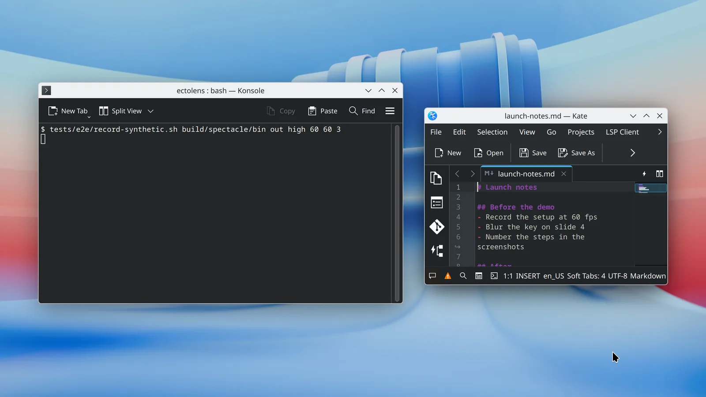
</p>

Ectolens is a fork of Spectacle, the screenshot tool that comes with KDE
Plasma. It keeps Spectacle's shortcuts and marking tools, copies your
Spectacle settings on its first start, and stays close to KDE's code so that
KDE's fixes keep coming in ([Staying close to KDE](#staying-close-to-kde)).

**Install it** from COPR on Fedora 44 and 45: `sudo dnf copr enable
omgrant/ectolens`, `sudo dnf install ectolens`, then `ectolens-shortcuts take`
to move Spectacle's shortcuts to it. On any other KDE Plasma distribution with
Qt 6.11 and KDE Frameworks 6.30 or newer, `install.sh` builds it from this
source for you alone. Either way, Spectacle stays installed, and its shortcuts
can go back to it: [Installing](#installing).

## What Ectolens adds to Spectacle

What changed from Spectacle's master branch of November 1, 2026, the day
Ectolens started from it. Each row links to its section.

| | Spectacle | Ectolens |
|---|---|---|
| [Take a window from the overlay](#take-a-window-with-a-click) | Drag a frame around it | Point at it and click |
| [Undo and Redo in the overlay](#take-a-window-with-a-click) | The marks | The marks and the frame's moves and resizes, in order |
| [A picture or a video of the same frame](#capture-or-record-the-same-frame) | Switch the overlay to a recording mode first | **Capture** and **Record** side by side |
| [What a capture does next](#what-a-capture-does-next) | A button for each, in a row below the frame | Set once in After Capture, so Capture is the one button |
| [Recording quality](#quality-and-frame-rate) | Fixed for each format | Small File, High, Best or your own settings |
| [Frame rate](#quality-and-frame-rate) | Up to 60 per second | 30, 60, 120 or your screen's own |
| [Encoders](#encoders-and-their-settings) | The best H.264 or VP9 encoder found | For MP4: x264, x265, SVT-AV1 or NVENC, your pick, or the system's own H.264 where FFmpeg lacks it |
| [Sound](#separate-sound-tracks) | System sound and microphone mixed into one track | Mixed, or each on a track of its own too |
| [Pause a recording](#pause-crash-safe-mp4-and-dropped-frames) | No | Yes, and the pause stays out of the file |
| [An MP4 cut short by a crash](#pause-crash-safe-mp4-and-dropped-frames) | Won't play | Plays |
| [Dropped frames](#pause-crash-safe-mp4-and-dropped-frames) | Not shown | Counted on the recording bar |
| [A marking tool's options](#labels-badges-and-text-boxes) | A bar from the left end of the tool row | A row right above the tool's own button |
| [Words on a capture](#labels-badges-and-text-boxes) | Lines you break yourself | Labels, and boxes whose words wrap |
| [Colors and fonts for marks](#colors-and-fonts) | Qt's color and font dialogs | Menus of their own, with fonts shown in their own faces |
| [Blur private information](#blur-whats-private) | By hand, with Blur or Pixelate | Found and blurred for you |
| [Exact capture sizes](#exact-sizes) | No | Typed or picked, with the window resized to fit |
| [QR codes](#pick-a-color-measure-read-a-qr-code-pin) | Read in the window after a capture | Read in the overlay as you frame |
| [Pick a color, measure, pin](#pick-a-color-measure-read-a-qr-code-pin) | No | Pick Color, Measure, Pin |
| [AI agents](#captures-for-ai-agents) | No | An MCP server; nothing is sent until you press Send |
| [Look](#ectos-look-or-kdes) | KDE's | Ecto's, or KDE's |

The pictures below with a divider sweeping across them show the same moment
in Spectacle 6.7.5, the version Plasma 6.7 ships, and in Ectolens, filmed on
the same desktop.

## The overlay

### Take a window with a click

Before anything is framed, Spectacle shows its marking tools and a toolbar of
actions, and asks you to click and drag. Ectolens shows one line that says
what you can do, and outlines the window under the pointer with its size, so
a click takes it. A click on the desktop takes the whole screen, Enter takes
every screen, and a drag still frames any area.

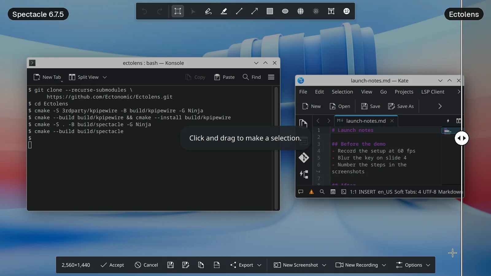

Undo and Redo cover the frame as well as your marks: they take back its moves
and resizes in the order you made them. In Spectacle they take back only the
marks.

### Capture or record the same frame

In Spectacle, a recording starts from New Recording, a menu of modes: a
rectangular region, the full screen or a window. In Ectolens, **Record** sits
beside **Capture** and records the frame you're already looking at, so a
picture and a video start the same way.

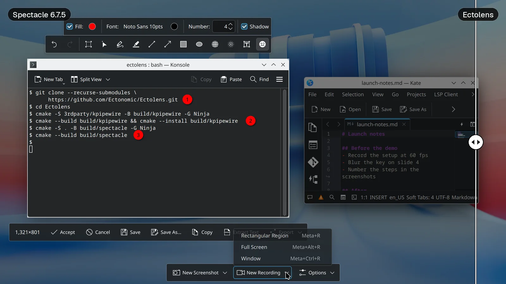

When you press Record, the still picture fades to your live screen, and the
recording bar, with the time, Pause and Stop, sits just outside the frame.
When the frame fills the screen, the bar sits inside it and still never shows
in the recording: KWin leaves the recording program's own windows out of what
it records. Press R to record from the keyboard, and Print Screen again to
stop.

### What a capture does next

Spectacle puts three rows around a frame: the marking tools above it; Accept,
Cancel, Save, Save As, Copy, Extract Text and Export below it; and New
Screenshot, New Recording and Options at the bottom of the screen. Ectolens
puts two: the marking tools above, and Capture, Record, Extract Text and its
tools below.

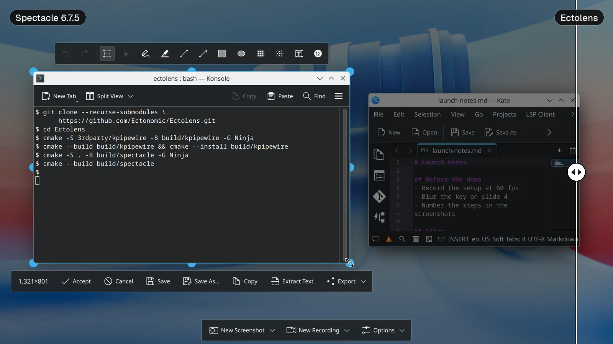

What a capture does next is set once, in **After Capture** on Capture's
arrow, so Capture is the one button to press. The choices are to open it in
an app, save it to a folder or ask where each time, show it in its folder,
copy the picture or its file's path, and share it. Choose any mix, and
Ectolens does all of them each time you press Capture or Enter. To start
with, After Capture copies the picture, or follows Spectacle's copy setting
if you had one. A recording is always saved, in your Videos folder, and opens
in the Ectolens window when Open with is set to Ectolens.

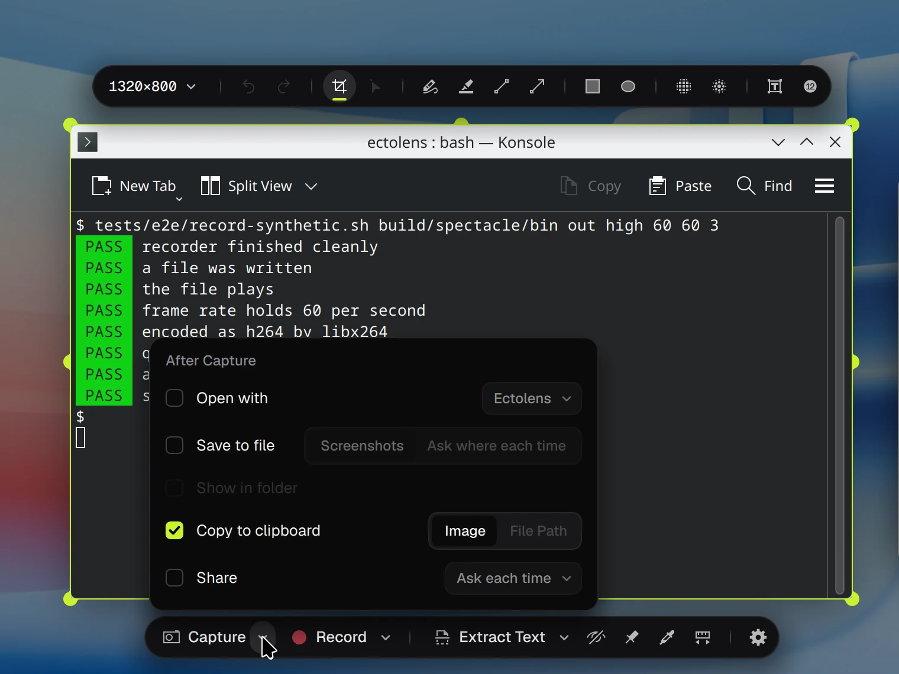

## Recording

Spectacle records with KPipeWire, KDE's screen recording library. Ectolens
records with its own copy of KPipeWire, which adds the choices below and fixes
six of KPipeWire's bugs. The KPipeWire your system uses is never replaced.

### Quality and frame rate

Record's arrow holds the choices for the next recording. What to include
(system sound, the microphone and the pointer) and the format (MP4, WebM, GIF
or WebP) are Spectacle's own choices. The quality and the frame rate are new.

Spectacle records each format at one fixed quality. In Ectolens, **Small
File**, **High** and **Best** each say what they cost: with x264, a minute of
a full 3440×1440 screen takes about 10, 27 or 28 MB. High keeps text sharp
and plays everywhere. Best keeps every color detail for editing later, though
Firefox and some phones can't play it. Spectacle records at up to 60 frames a
second; Ectolens offers 30, 60 and 120, and your screen's own rate when it's
faster.

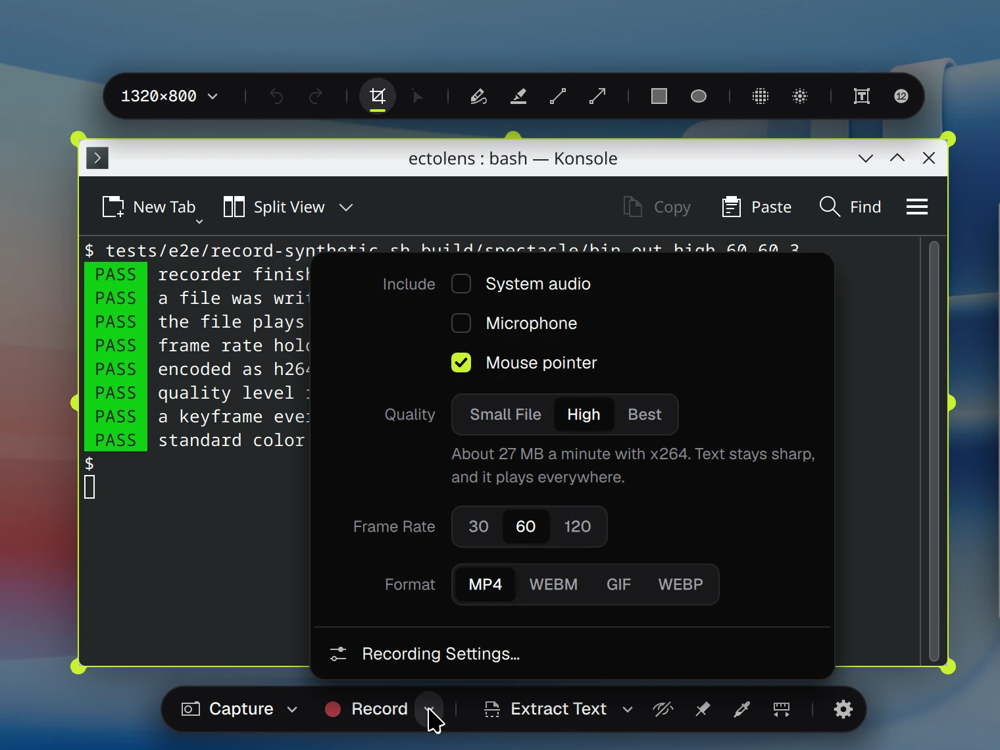

### Encoders and their settings

Spectacle records MP4 with the best H.264 encoder it finds, which can be the
graphics chip's own through VA-API, and WebM with VP9. In Ectolens, Settings ›
Recording picks the MP4 encoder from the ones this computer has: x264, x265
or SVT-AV1 on the processor, or NVIDIA's NVENC on the graphics card. NVENC
records H.264, HEVC and AV1, checked at 60 frames a second on a GeForce RTX card. Ectolens starts with x264. When this computer's FFmpeg doesn't have the
encoder you picked (Fedora's and openSUSE's own FFmpeg have no x264),
Ectolens records with the system's own H.264 encoder, the way Spectacle does,
and Recording Settings says so instead of recording nothing.

You can also set the encoder's own settings: its speed, quality level,
keyframes, B-frames, full color detail (4:4:4) and options in the encoder's own
words, and the quality becomes Custom. **Check Speed** encodes a moving test
picture the size of your screen with your settings and tells you how many
times faster than needed this computer encodes it, so you know before you
record whether it keeps up.

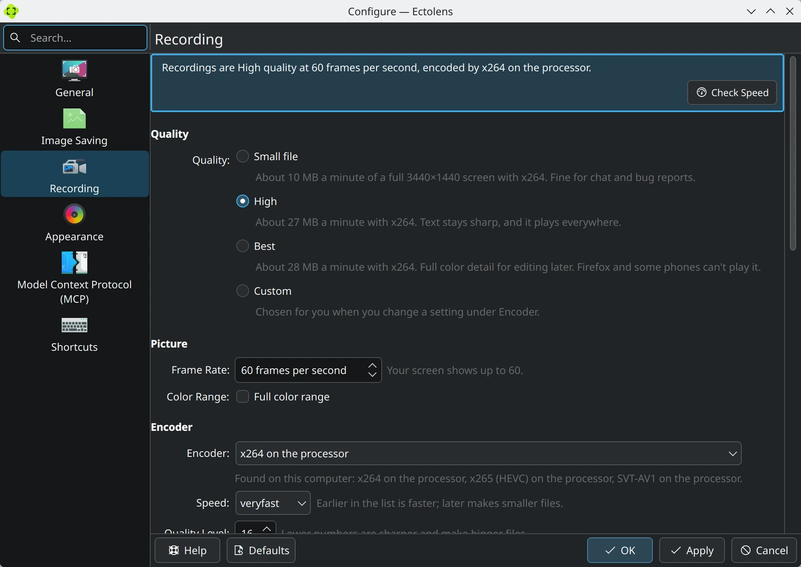

### Separate sound tracks

Spectacle mixes system sound and the microphone into one track, and Ectolens
does the same to start with. Check **Separate tracks for editing** in
Settings › Recording, and the file holds three: the mix first, which is the
one players play, then system sound alone and the microphone alone, so a
video editor can change one without the other.

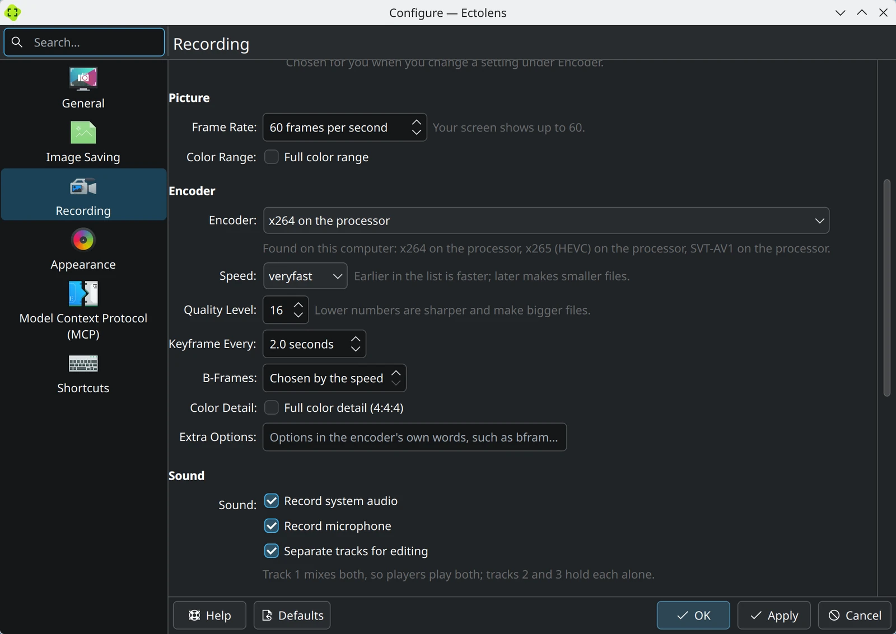

### Pause, crash-safe MP4 and dropped frames

- **Pause.** Spectacle can't pause a recording. Ectolens's Pause leaves the
  paused time, and the sound during it, out of the file.
- **A crash can't ruin an MP4.** In Spectacle, an MP4 cut short by a crash
  won't play. Ectolens writes MP4 files in pieces as it records and turns them
  into an ordinary file at the end, as OBS Studio's hybrid MP4 does, so a
  recording cut short by a crash still plays. With an FFmpeg older than 7.1
  the file keeps its pieces.
- **Dropped frames are counted** on the recording bar, so you know at once if
  the computer fell behind. Spectacle doesn't show them.
- **60 frames a second stays 60.** KPipeWire dropped any frame that arrived a
  little early, so a 60 fps screen recorded at about 40 frames a second.
  Ectolens's copy fixes that, along with five more of KPipeWire's bugs, listed
  in [docs/deferred.md](docs/deferred.md#upstream-bugs-fixed-here-could-be-offered-back-to-kde).

## Marking up

Ectolens keeps Spectacle's marking tools, from KDE's KQuickImageEditor. It
changes where their options open, how words and numbers look, how you pick
colors and fonts, and where the tools sit in the window.

### Labels, badges and text boxes

Spectacle opens a tool's options in a bar above the tool row, starting at its
left end, whichever tool you picked. Ectolens opens them right above the
tool's own button. Its Text and Number tools have a new look: words on a
rounded label, and numbers on round badges that count up with each click, in
Ecto green to start.

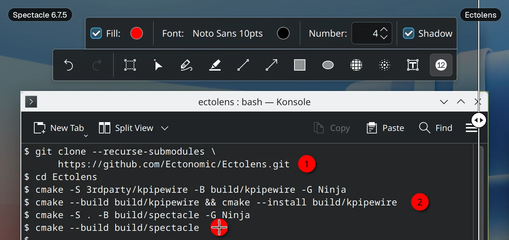

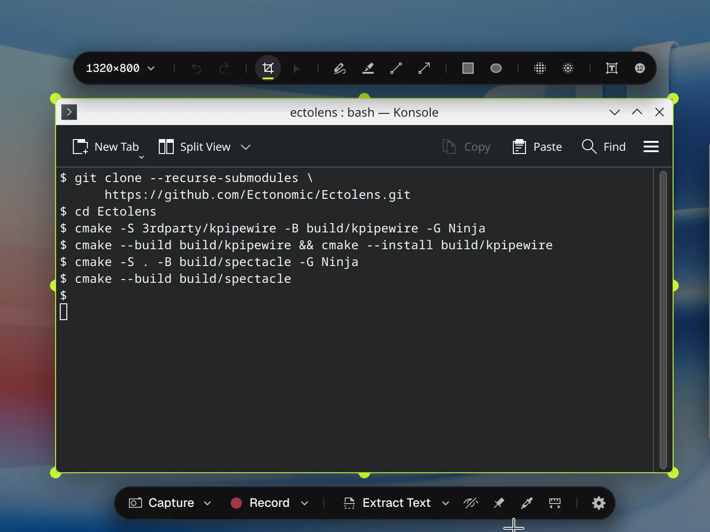

In Spectacle, words on a capture run on until you break the line. In
Ectolens, a drag with the Text tool draws a box: the words wrap inside it as
you type, and its handles resize it and wrap them again. A click without a
drag still makes a plain label.

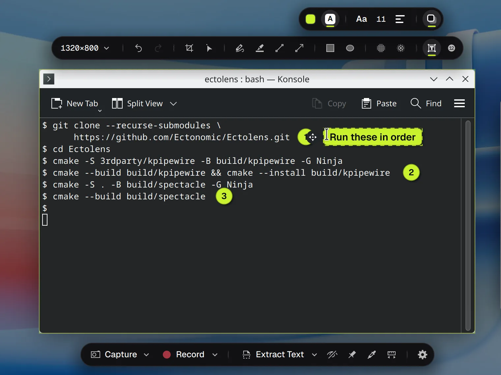

### Colors and fonts

Where Spectacle opens Qt's color and font dialogs, Ectolens has menus of its
own. The color menu has twelve colors, Ecto green first, None for a shape's
outline or fill, and a picker for any color by its saturation, brightness,
hue, opacity or hex value. The font menu shows every installed font in its
own face, Geist first, with a search and the weight.

<p>
  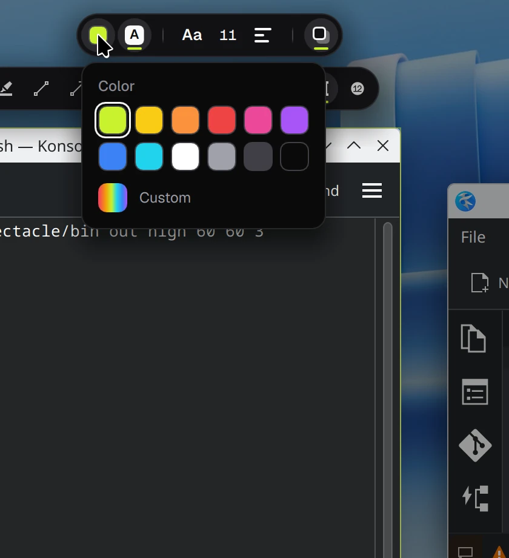
  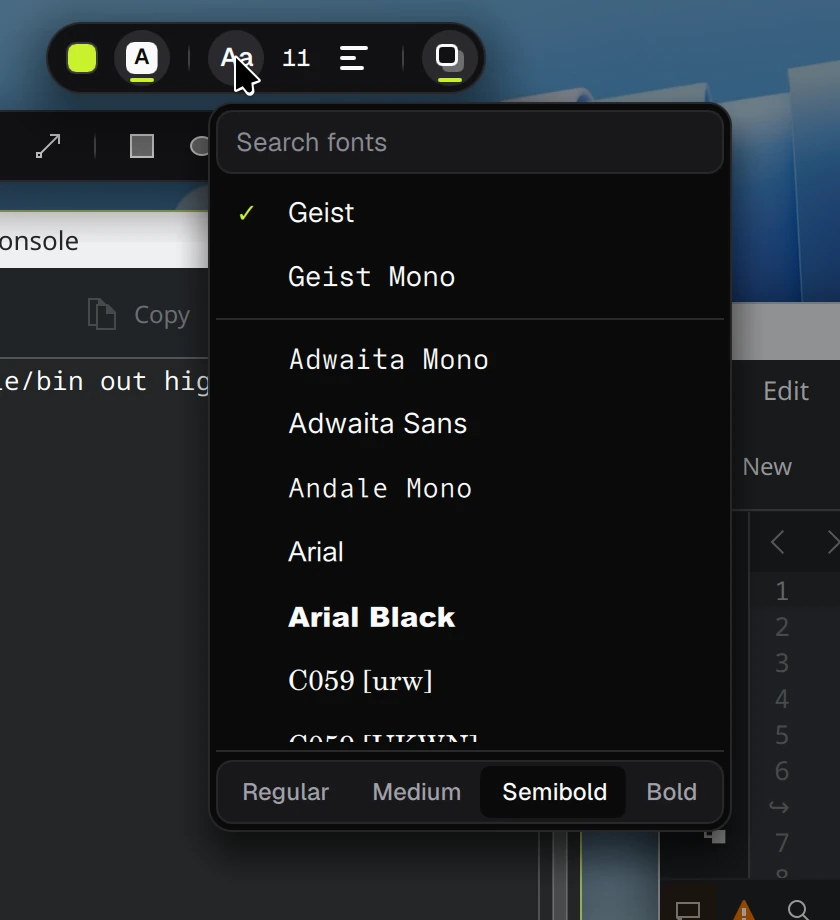
</p>

### Marking in the window

Spectacle's window opens on a toolbar of actions, with marking behind its
Edit button. Ectolens's window has the marking tools in its top bar from the
start, Copy, Save and Extract Text at the bottom, and a line saying what
After Capture did.

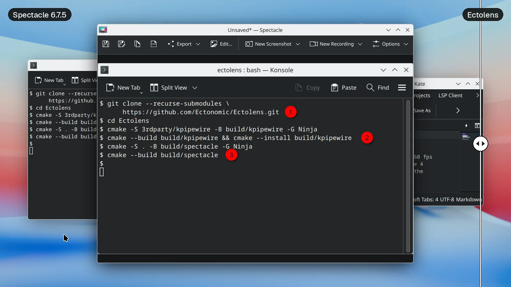

## New tools in the overlay

### Blur what's private

Spectacle's Blur and Pixelate tools hide things by hand. **Hide Private
Info** finds them for you: it reads the words in the frame with Tesseract,
the text recognition Spectacle's Extract Text uses, and blurs email
addresses, home-folder paths, and keys and tokens, such as OpenAI, GitHub,
GitLab, Slack, AWS and Google keys.

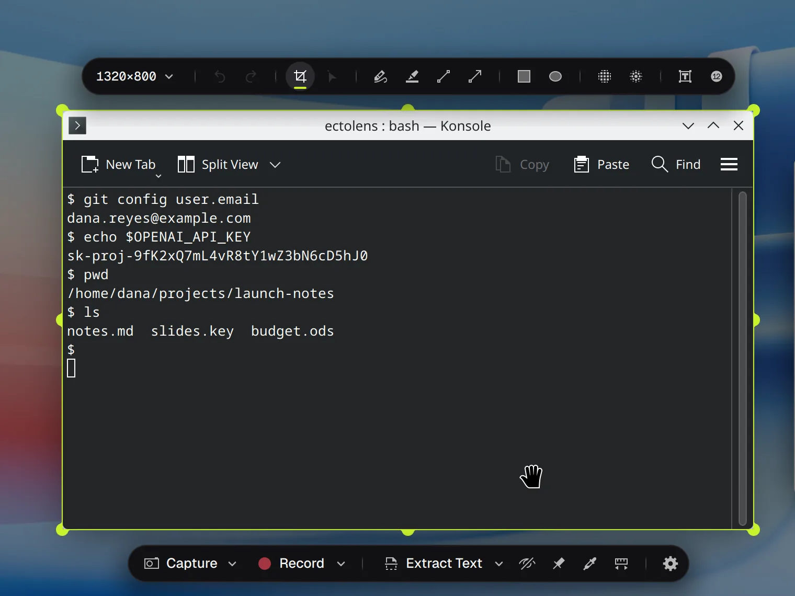

### Exact sizes

The frame's size label is also a menu of sizes: type a width and height, or
pick Full HD, HD, QHD, ultrawide, square or phone. When the frame holds a
window, Ectolens resizes the window to fit and puts it back afterward.

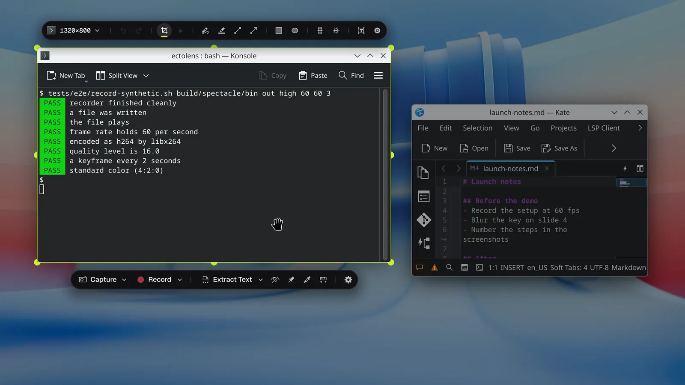

### Pick a color, measure, read a QR code, pin

- **Pick Color** magnifies the pixels under the pointer and copies the color
  you click as its hex value.
- **Measure** draws a line and shows its length, and the width and height it
  spans, in pixels.
- **Open QR Code** appears while the frame holds a QR code, and opens or copies
  what it says. Spectacle reads QR codes in its window, after a capture.
- **Pin** keeps the capture on top of your other windows, where you can drag
  it anywhere.

<p>
  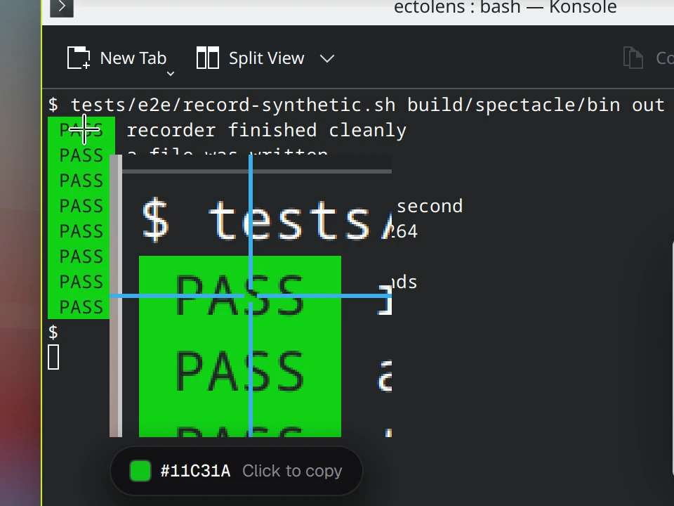
  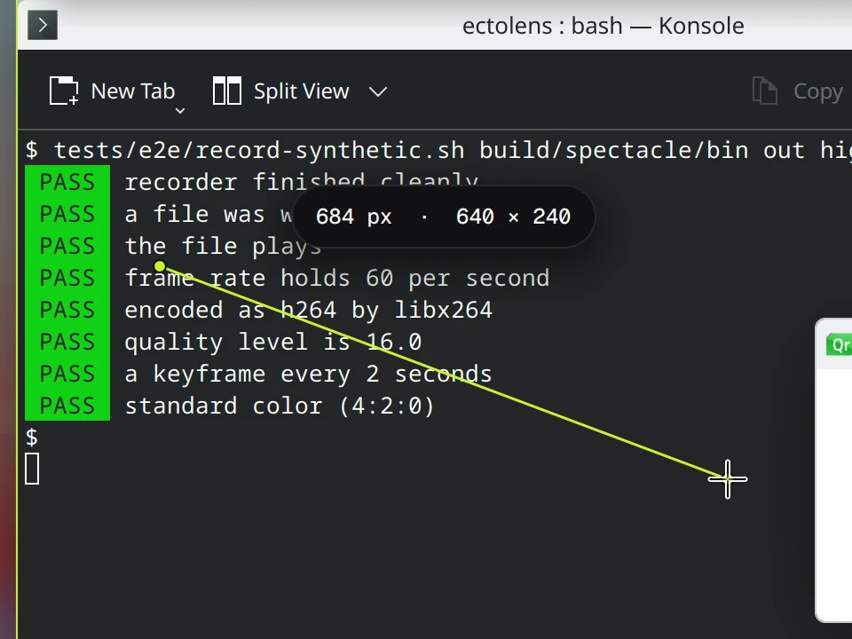
</p>
<p>
  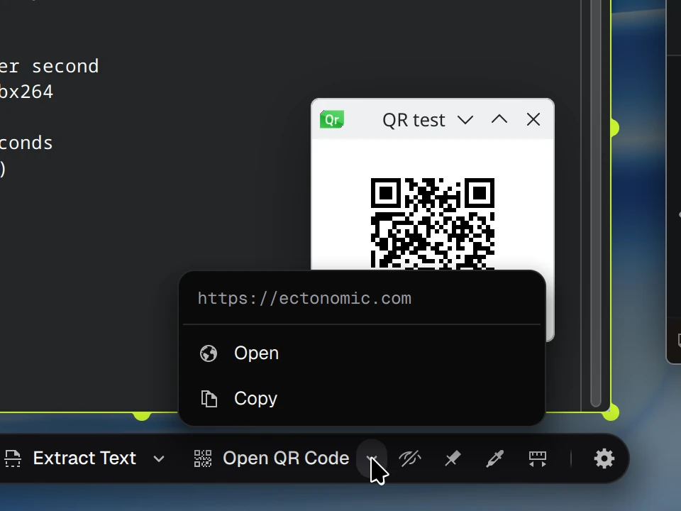
  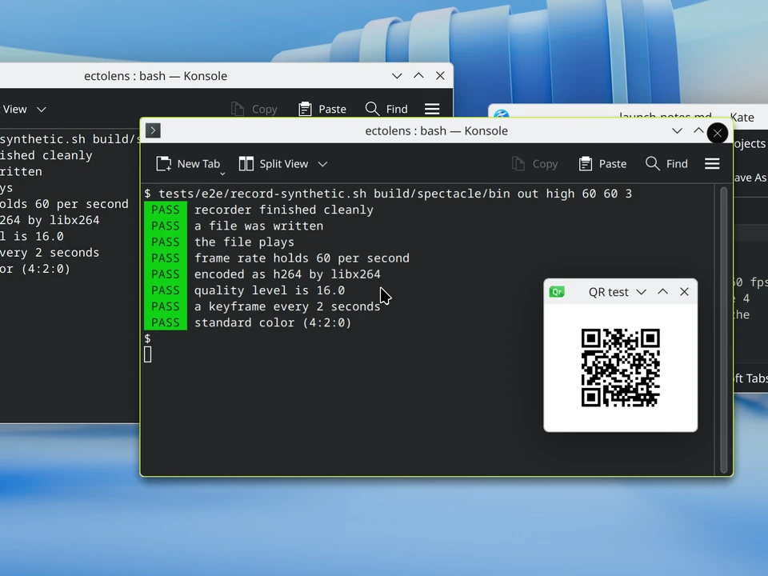
</p>

## Captures for AI agents

Ectolens comes with an MCP server, `ectolens-mcp`, so an AI agent such as
Claude Code can ask for a picture or a recording of your screen. You decide
what it gets:

- **You send each one.** Ectolens frames what the agent asked for, then the
  request pops up in the middle of your screen. The screen around the frame
  dims, and what's in the frame stays bright. The request shows the agent's
  reason and a preview of exactly what the agent would get. Press **Send**,
  **Don't Send**, or **Adjust First** to move the frame or mark the picture up
  before you send it. Nothing reaches the agent before that.
- **Private information is blurred first.** In a picture, email addresses,
  keys, tokens and home-folder paths are blurred before you decide, and the
  request says how many it found. When the agent needs to see them, uncheck
  **Blur private information** in the request: the blurs come off the preview
  and the picture for that request only. If you move or enlarge the frame
  with Adjust First, Ectolens reads the frame again and blurs what's private
  in it before sending. The window titles an agent lists are blurred the same
  way. A recording shows your screen as it is, and the request for one says
  so.
- **Words instead of pixels.** An agent can ask for the words in a capture,
  read with Tesseract, which costs it fewer tokens than a picture when it only
  needs to read an error.
- **Windows by name.** An agent can list your windows and ask for one by its
  app or its title.

This consent covers what an agent asks for through `ectolens-mcp`. An agent
that can run commands on your computer, as Claude Code can, could still take
a screenshot another way, such as with Ectolens's own command line.

The tools are `list_windows`, `capture`, `record_start` and `record_stop`.
Agents are off until you turn them on in Settings › Model Context Protocol
(MCP), which also shows the command that connects Claude Code:

```sh
claude mcp add ectolens -- /path/to/ectolens-mcp
```

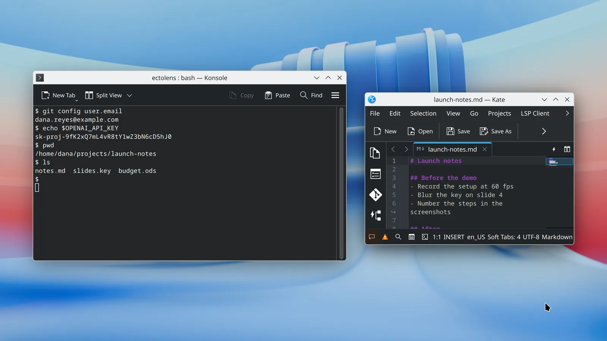

## Ecto's look, or KDE's

Spectacle draws in your KDE colors and fonts. Ectolens draws its overlay and
window in the colors of Ectonomic's Ecto design family, with the Geist
typeface, which ships with it. In Settings › Appearance you can switch back
to your KDE colors and fonts, use your KDE accent color or any other, and
choose how dark the rest of the screen gets.

<p>
  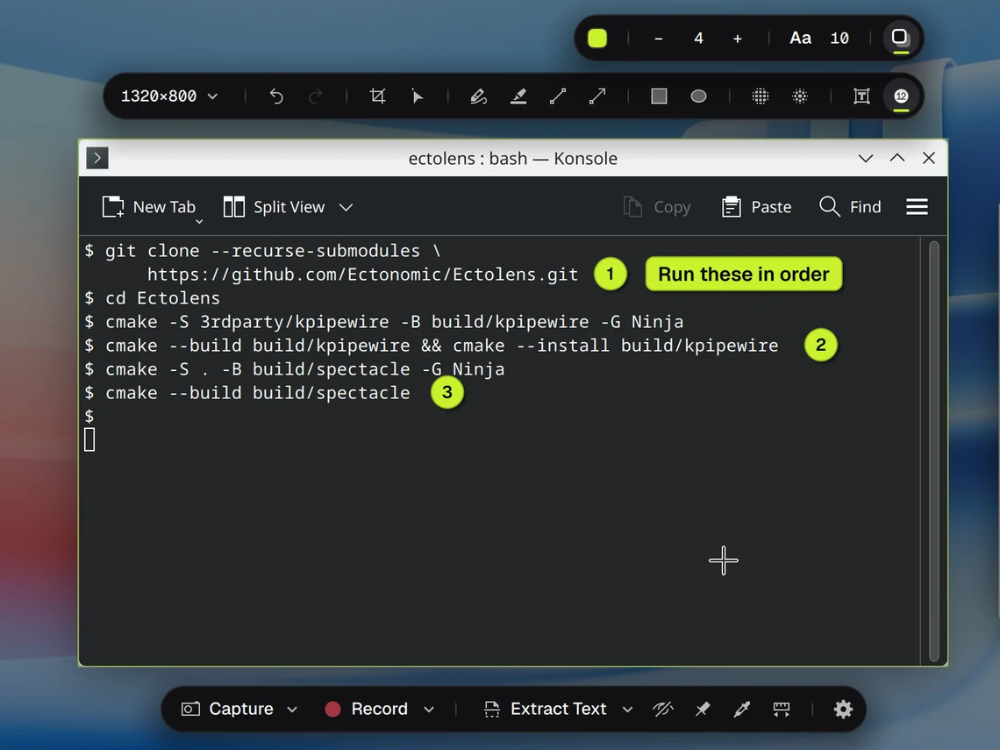
  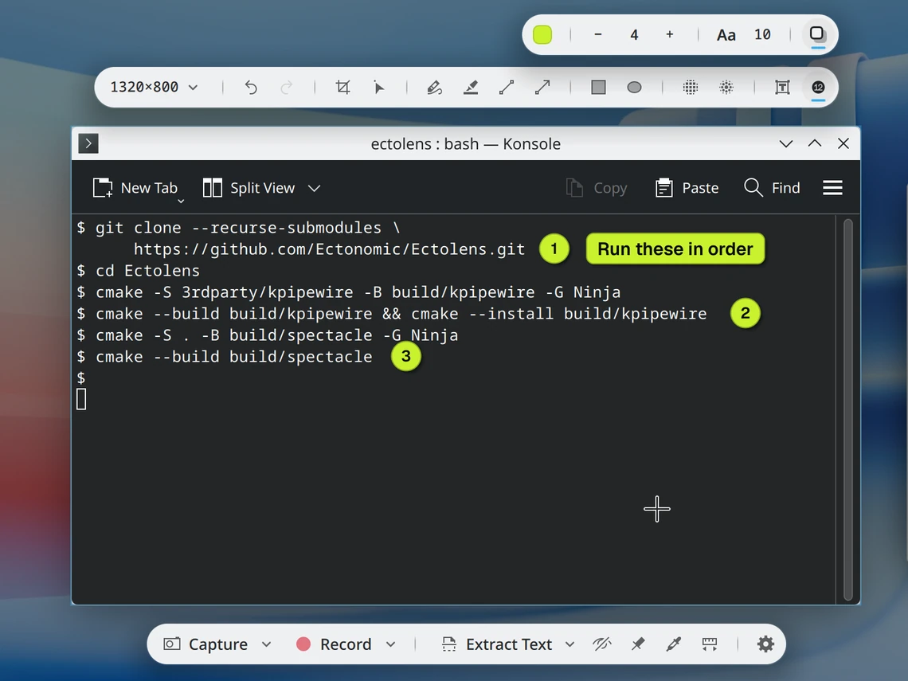
</p>

In Ecto's look the overlay is always dark, since it sits over your screen.
The Ectolens window follows Plasma's color scheme: dark in a dark scheme, and
light in a light one.

<p>
  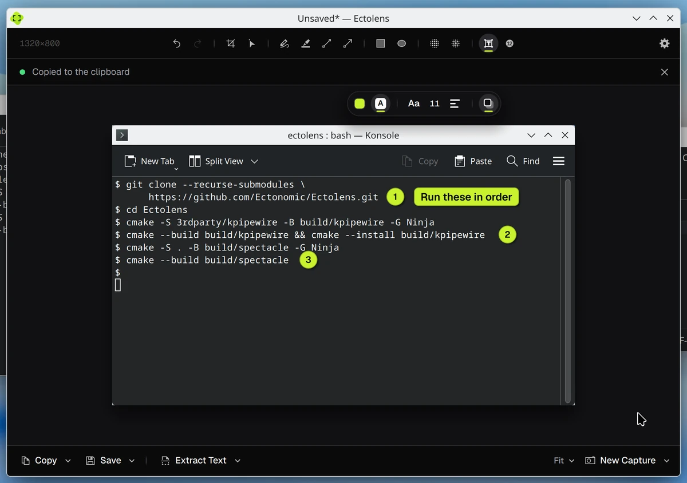
  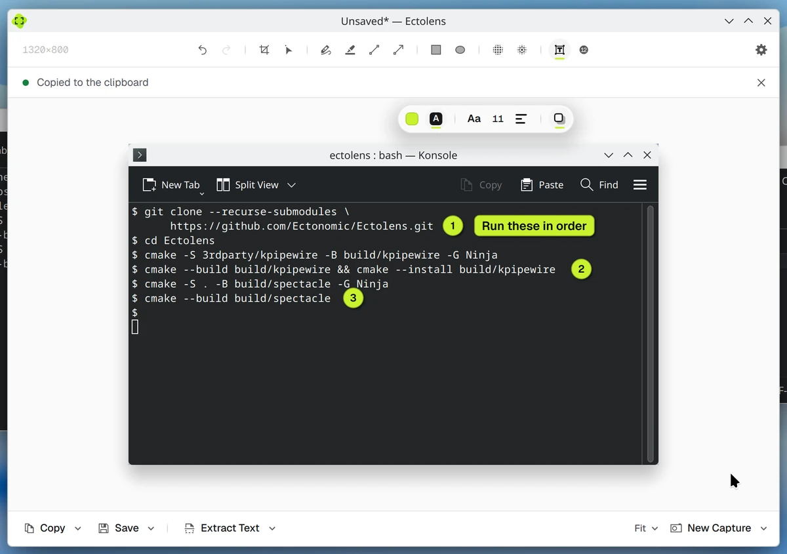
</p>

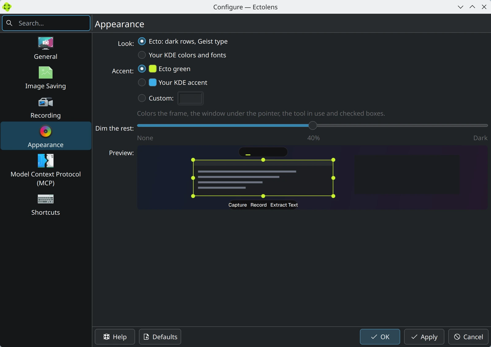

## Status

Ectolens is built and tested on Plasma 6.7 on Wayland, with Qt 6.11, and its
install is checked on Plasma 6.8 too ([Installing](#installing)). There are no
releases yet: the Fedora package is built from the latest code. Its new words
are in English only. [docs/deferred.md](docs/deferred.md) lists what is
unfinished, what no test covers yet, and where Ectolens differs from its
design documents.

## Installing

### Fedora 44 and 45

The package is in COPR, rebuilt from the latest code after every change:

```sh
sudo dnf copr enable omgrant/ectolens
sudo dnf install ectolens
ectolens-shortcuts take
```

It installs beside Spectacle and replaces none of its files.
`ectolens-shortcuts take`, run in your Plasma session, gives Ectolens
Spectacle's capture shortcuts (Print Screen, Meta+Shift+S and the rest);
`ectolens-shortcuts give-back` returns them, so run it before
`sudo dnf remove ectolens`. `sudo dnf upgrade` brings each new build.

### Any KDE Plasma distribution

`install.sh` builds Ectolens from this source and installs it for you alone.
It replaces nothing on your system: Spectacle stays installed, and Ectolens
takes over its shortcuts until you uninstall it.

```sh
git clone --recurse-submodules https://github.com/Ectonomic/Ectolens.git
cd Ectolens
./install.sh
```

It works in five steps:

1. It checks for KDE Plasma, Qt 6.11 or newer and KDE Frameworks 6.30 or
   newer. On an older system it says what's missing and stops, with nothing
   changed.
2. It shows the command that installs the packages the build needs from your
   distribution, and runs it only if you say yes. That is the only step that
   uses `sudo`.
3. It builds Ectolens, with its own copy of KPipeWire, into
   `~/.local/opt/ectolens`.
4. It links Ectolens's menu entry, D-Bus services, notifications and icons
   into `~/.local/share`, where Plasma finds them.
5. It moves Spectacle's capture shortcuts (Print Screen, Meta+Shift+S and the
   rest) to Ectolens, and keeps a record of them.

To update, run `git pull --recurse-submodules` and `./install.sh` again. Your
settings and shortcuts stay as they are.

To uninstall:

```sh
~/.local/opt/ectolens/share/ectolens-install/uninstall.sh
```

It gives Spectacle back the shortcuts it had, removes the install folder and
its links, and asks before removing your Ectolens settings.

`install.sh` and `uninstall.sh` are checked on these distributions, each in a
clean container by a new user, with Plasma's KWin and Spectacle installed:

| Distribution | Plasma | Qt | KDE Frameworks | Result |
|---|---|---|---|---|
| Fedora 44 | 6.8.2 | 6.11.2 | 6.31.0 | Installs. Fedora's FFmpeg has no x264, so recordings use the system's own H.264 encoder |
| openSUSE Tumbleweed | 6.8.2 | 6.12.0 | 6.31.0 | Installs. Recordings use the system's own H.264 encoder, as on Fedora |
| Arch Linux | 6.8.2 | 6.12.0 | 6.31.0 | Installs. Recordings use x264 |
| Debian testing | 6.7.4 | 6.11.2 | 6.30.0 | Installs. Recordings use x264 |
| KDE neon | 6.8.2 | 6.11.1 | 6.31.0 | Installs. Recordings use x264, and its FFmpeg 6.1 keeps them as fragmented MP4 files |
| Debian 13 | 6.3.6 | 6.8.2 | 6.13.0 | Refused: Qt is older than 6.11 |
| Kubuntu 26.10 | 6.7.5 | 6.11.2 | 6.29.0 | Refused: KDE Frameworks is older than 6.30 |

After each install, the check takes a screenshot and a five-second recording
with the installed Ectolens, presses Print Screen through Plasma's shortcut
service and runs `install.sh` again. Then it uninstalls and confirms that
Spectacle has every shortcut it had and that nothing of Ectolens is left but
its settings.

## Building and running

KPipeWire, KDE's screen recording library, carries Ectolens's recorder fixes
and comes as a submodule:

```sh
git clone --recurse-submodules https://github.com/Ectonomic/Ectolens.git
cd Ectolens
```

The build needs what Spectacle and KPipeWire need: Qt 6, KDE Frameworks 6,
LayerShellQt, PipeWire and FFmpeg, with CMake and Ninja. Ectolens's copy of
KPipeWire installs into a prefix inside the build folder, so the KPipeWire
your system uses is never replaced.

```sh
cmake -S 3rdparty/kpipewire -B build/kpipewire -G Ninja -DCMAKE_INSTALL_PREFIX=$PWD/build/prefix
cmake --build build/kpipewire && cmake --install build/kpipewire

cmake -S . -B build/spectacle -G Ninja -DCMAKE_INSTALL_PREFIX=$PWD/build/prefix \
      -DCMAKE_PREFIX_PATH=$PWD/build/prefix -DCMAKE_INSTALL_RPATH=$PWD/build/prefix/lib64
cmake --build build/spectacle && cmake --install build/spectacle
```

Ectolens builds against the installed KPipeWire, so install KPipeWire again
after changing it.

The program is `build/prefix/bin/ectolens`, with its MCP server,
`ectolens-mcp`, beside it. Its app id is
`com.ectonomic.ectolens`, and it keeps its settings in `ectolensrc`. On its
first start it copies your Spectacle settings once.

KWin 6.7 lets a program take screenshots and recordings only when an
installed desktop file names it. `install.sh` sets that up. For a development
build, either install into a prefix whose `share` folder your Plasma session
reads (in `XDG_DATA_DIRS`), or, as Spectacle's own README suggests, start your
session with `KWIN_SCREENSHOT_NO_PERMISSION_CHECKS=1` and
`KWIN_WAYLAND_NO_PERMISSION_CHECKS=1`. Ectolens asks for the keys Spectacle
uses (Print Screen, Meta+Shift+S and the rest); where Spectacle already has
them, give them to Ectolens in System Settings › Keyboard › Shortcuts.

## How it's built and tested

- **Unit tests:** `ctest --test-dir build/spectacle`. The AppStream test is an
  expected failure until Ectolens has a homepage.
  `mcp_starts_nothing_test` starts the MCP server the way an agent's session
  does and fails if that alone starts Ectolens; only a tool call may.
- **KPipeWire's tests:** `QT_QPA_PLATFORM=offscreen ctest --test-dir build/kpipewire`.
  NVENC rows run only with `ECTOLENS_GPU_TESTS=1`. `mediamonitortest` runs
  only in KDE's CI (`KDECI_BUILD`), because it starts its own PipeWire and
  plays a sound.
- **Recording end to end, with no screen captured:**
  `tests/e2e/record-synthetic.sh build/spectacle/bin OUT high 60 60 3`
  records a generated screen stream and checks the file's encoder, frame rate
  and color. Other presets and encoders are written the same way, such as
  `best 60 60 3` or `high:libsvtav1 60 60 3`.
- **The overlay and the window, off-screen:**
  `SCENARIO=annotate tests/e2e/overlay/run.sh build/prefix/bin OUT` runs
  Ectolens in a private headless KWin, drives it with real pointer and key
  input, and judges KWin's own screenshots. The scenarios are `frame`,
  `launch`, `printkey`, `pick`, `input`, `settings`, `desktops`, `tools`,
  `share`, `toggle`, `startup`, `annotate`, `toolclicks`, `textbox`,
  `textzoom`, `window`, `empty`, `video`, `fullrecord`, `frameundo`, `agent`
  and `agentoff`. The `agent` runs start `ectolens-mcp` as a made-up agent
  would and answer its requests in the overlay with real clicks and keys,
  judging the dimmed screen, the dialog and what each answer sent. Every run also holds each row,
  bar and open menu to the spacing standard in `src/Gui/EctoTheme.qml`
  (`tests/e2e/overlay/anatomy.py`). Nothing opens on your desktop. These runs
  need bubblewrap, `kwin_wayland`, Konsole, PipeWire, FFmpeg's
  `ffprobe`, and Python 3 with Pillow, NumPy, dbus-python and PyGObject. Pass
  the installed `build/prefix`: KWin grants screenshots only to the program
  its desktop file names.
- **Sound tracks, with stand-in devices:**
  `tests/e2e/record-soundtracks.sh build/spectacle/bin OUT separate` (or
  `mixed`) records in a private PipeWire whose only speaker and microphone are
  stand-ins playing two tones, with your sound devices hidden, and measures
  each track's tones. `SCENARIO=soundtracks` does the same through the app's
  own setting.
- **The install, on other people's computers:**
  `tests/install/stranger-check.sh` runs `install.sh` and `uninstall.sh` in a
  clean container of each distribution in [Installing](#installing), as a new
  user inside a headless KWin, and judges what they did from outside: the
  shortcut service, the files, a screenshot and a recording. It needs rootless
  Podman, and a graphics chip that isn't NVIDIA's for KWin to draw on.
  `PLANT=tests/install/plants/NAME.patch` adds a known fault first, to show a
  check catches it. `tests/install/rpm-check.sh` builds the Fedora package
  the way COPR does (`.copr/Makefile`, `packaging/ectolens.spec`), installs it
  with dnf beside Spectacle as a new user, and removes it again.
- **This README's pictures** are filmed the same way, in the off-screen KWin,
  with real pointer and key input: `tools/readme-pictures.sh` films every
  scene in `tests/e2e/overlay/readme-scenes.sh` and cuts the films into
  `docs/pictures/` (Kate too, for the editor beside the terminal). The
  pictures show KDE's Breeze Dark colors and KDE's Waterfall wallpaper, never
  a real desktop. `readme_pictures_test` holds the
  README, the cuts and the pictures to each other.

## Where things are

- `src/`: Spectacle's code and Ectolens's additions. The new interface is in
  `src/Gui/` (`CaptureOverlay.qml`, `ViewerPage.qml` and the `Ecto*.qml`
  parts).
- `3rdparty/kpipewire/`: the KPipeWire submodule. Its branch `ectolens` holds
  the recorder changes.
- `3rdparty/kquickimageeditor/`: Ectolens's copy of KQuickImageEditor 0.7.0,
  the marking tools. `README.ectolens.md` there lists every change from
  upstream.
- `design/`: the design proposals (`design/mock/`, plain HTML pages), the
  encoder benchmark (`design/bench/`) and the icon (`design/mark/`).
- `docs/deferred.md`: the list of unfinished work, untested areas and known
  differences. `docs/pictures/`: this README's pictures.
- `tests/`: the unit tests and the end-to-end runs.

## Staying close to KDE

The `main` branch follows KDE's Spectacle, and Ectolens's work is on the
`ectolens` branch, so KDE's fixes can still be merged in. For the same reason
the C++ classes keep Spectacle's names, and the translation domain is still
`spectacle`, so Spectacle's translations still load.

## License and credits

Ectolens is made by Grant Garrison and Claude, on the work of the people who
make Spectacle, KPipeWire and KQuickImageEditor at KDE. It keeps their
licenses: each file states its own (SPDX headers), and the license texts are
in [LICENSES/](LICENSES/). Their authors' copyright lines stay in every file
they wrote. The Geist typeface is under the SIL Open Font License (see
`src/fonts/`). The wallpaper in the design pages and in this README's
pictures is KDE Plasma's "Waterfall" by Krystian Zajdel, CC-BY-SA-4.0 (see
`design/mock/img/WALLPAPER.md`).

Ectolens is not a KDE project. Please report problems with Ectolens in this
repository's issues, not to KDE.
